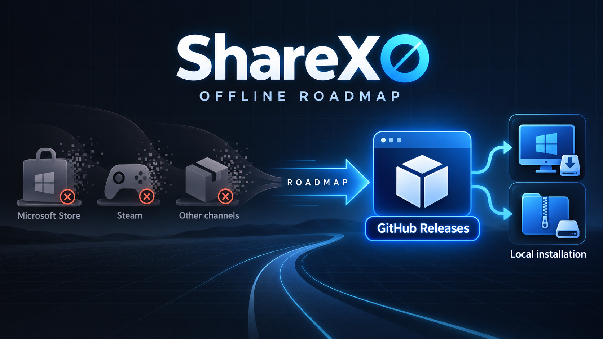

# ShareXO

**ShareX Offline — local-first screen capture without upload or sharing features.**

[](https://github.com/paulpf/ShareXO/actions/workflows/build.yml)
[](LICENSE.txt)
[](https://github.com/ShareX/ShareX)

ShareXO is a privacy-focused Windows fork of [ShareX](https://github.com/ShareX/ShareX). The **O stands for Offline**: upload and sharing functionality is intentionally absent. The fork keeps ShareX's mature screen-capture, recording, image-editing, OCR, QR-code and local automation features while removing its online-sharing stack.

The guiding rule is simple: a capture stays local unless the user explicitly starts an operation that can access the network.

> [!IMPORTANT]
> ShareXO is an independent fork and is not an official ShareX release. Upstream documentation may describe upload, destination and sharing features that do not exist here.

## Table of contents

- [What is different from ShareX?](#what-is-different-from-sharex)
- [Network behavior](#network-behavior)
- [Included features](#included-features)
- [Distribution roadmap](#distribution-roadmap)
- [Building from source](#building-from-source)
- [Diagnostics](#diagnostics)
- [Reporting issues](#reporting-issues)
- [Upstream and license](#upstream-and-license)

## What is different from ShareX?

| Area | ShareXO behavior |
| --- | --- |
| Uploads | Removed from the UI, task pipeline, hotkeys, CLI and source tree |
| Cloud destinations | Removed, including built-in and custom uploaders |
| URL sharing and shortening | Removed |
| OAuth and uploader credentials | Removed with `ShareX.UploadersLib` |
| Browser integration | Native messaging host and Chrome/Firefox registration removed |
| AI image analysis | Removed, including OpenAI, Gemini and OpenRouter providers |
| Remote image loading | Editor “Load from URL” and remote history thumbnails removed |
| FFmpeg downloads | Automatic/downloader code removed; local `ffmpeg.exe` execution remains |
| Update checks | Automatic checks disabled; manual checks remain available |
| Clipboard copies | Writes are verified and retried to reduce intermittent copy failures |

The removal covers the complete upload workflow rather than merely hiding buttons. Upload jobs, after-upload actions, uploader configuration, destination settings, upload progress, upload dialogs, `.sxcu` registration and the uploader library itself are no longer part of the application.

Existing ShareX configuration files remain broadly compatible with local workflows. Surviving task-flag values were preserved where possible. An existing `UploadersConfig.json` is left untouched but is no longer read or written.

## Network behavior

ShareXO does not perform an automatic update check at startup and no longer contains the application upload paths described above.

Network access can still happen in these explicit or external situations:

- selecting a manual update or development-build check;
- running a user-configured external action or program that accesses the network;
- restoring NuGet packages or downloading build dependencies while compiling the project;
- CI packaging, which downloads the selected FFmpeg build.

This is a description of the intended application behavior, not a claim that Windows, third-party binaries or user-defined actions are offline. The fork has not been presented as a formal security audit or sandbox.

## Included features

ShareXO retains the local parts of ShareX, including:

- fullscreen, window, monitor, region, scrolling and automatic capture;
- screen recording and GIF recording with a locally available FFmpeg binary;
- the region-capture annotation tools and integrated image editor;
- crop, shapes, arrows, text, freehand drawing, blur, pixelation, highlighting and image effects;
- save-to-file, copy-to-clipboard, print, pin-to-screen and open-in-Explorer workflows;
- OCR, QR-code generation and scanning, color picker, ruler and screen inspection tools;
- image viewer, comparer, combiner, splitter, thumbnailer and metadata tools;
- configurable hotkeys, watch folders and local external actions;
- capture history and configurable file naming.

The exact feature set follows the `develop` branch and can change as upstream ShareX evolves.

## Distribution roadmap



ShareXO is intended to use **GitHub Releases as its only distribution channel**. Future cleanup will remove Microsoft Store, Steam and other store-specific packaging and release paths, leaving conventional local installation and portable packages downloaded directly from this repository.

This transition is not complete yet: store-specific build configurations and CI jobs still exist in the current source tree. Until they are removed, GitHub remains the authoritative project location, but the build system may still produce additional package formats.

## Building from source

### Requirements

- Windows
- Git
- .NET 10 SDK
- the Windows SDK required by `net10.0-windows10.0.22621.0`

Clone the fork and build the x64 Release configuration:

```powershell
git clone https://github.com/paulpf/ShareXO.git
cd ShareXO
dotnet restore --runtime win-x64 ShareX.sln
dotnet build --no-restore --configuration Release -p:Platform=x64 --self-contained true ShareX.sln
```

For ARM64, replace `win-x64` with `win-arm64` and `x64` with `ARM64`. The main application output is written below `ShareX/bin/<Configuration>/<RuntimeIdentifier>/`. The GitHub Actions workflow additionally builds installer and portable artifacts.

## Diagnostics

Runtime diagnostics are written to a monthly log file:

```text
%USERPROFILE%\Documents\ShareX\Logs\ShareX-Log-YYYY-MM.txt
```

If a custom personal folder is configured, the `Logs` directory is located there instead. The active log can also be opened from **Debug → Show debug log → Open log file**.

Logs can contain local file names, paths and command-line arguments. Review them before attaching them to a public issue.

## Reporting issues

Report fork-specific problems in the [ShareXO issue tracker](https://github.com/paulpf/ShareXO/issues). When reporting an intermittent capture or clipboard problem, include:

- the approximate time of the failure;
- whether it occurred after direct capture or in the image editor;
- the relevant excerpt from the ShareX log;
- the Windows version and ShareXO commit or build version.

For behavior that is reproducible in an unmodified ShareX build, consult the [upstream ShareX repository](https://github.com/ShareX/ShareX).

## Upstream and license

ShareXO is based on ShareX, Copyright © 2007–2026 ShareX Team and contributors. The fork remains licensed under the GNU General Public License; see [LICENSE.txt](LICENSE.txt).

Useful upstream resources:

- [ShareX repository](https://github.com/ShareX/ShareX)
- [ShareX documentation](https://getsharex.com/docs/)
- [ShareX image editor documentation](https://getsharex.com/docs/image-editor)
- [ShareX region capture documentation](https://getsharex.com/docs/region-capture)
- [ShareX command-line documentation](https://getsharex.com/docs/command-line-arguments)
